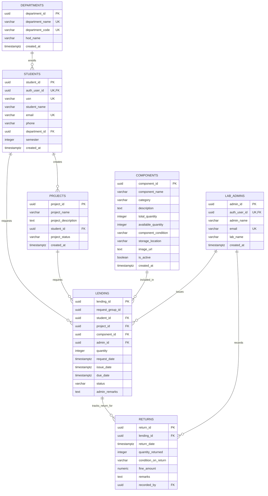

# Entity-Relationship (ER) Diagram
## College Project Component Lending & Tracking System

### Cardinality Summary
1. **DEPARTMENTS to STUDENTS**: `1 : N` (One department has many students; each student belongs to one department).
2. **STUDENTS to PROJECTS**: `1 : N` (One student can register multiple academic projects).
3. **STUDENTS to LENDING**: `1 : N` (One student can initiate multiple component requests).
4. **PROJECTS to LENDING**: `1 : N` (One project can have multiple component allocations).
5. **COMPONENTS to LENDING**: `1 : N` (One component catalogue entry can be requested in multiple lending records).
6. **LAB_ADMINS to LENDING**: `1 : N` (One lab admin can approve and issue multiple lending records).
7. **LENDING to RETURNS**: `1 : N` (One lending transaction can have multiple partial returns).
8. **LAB_ADMINS to RETURNS**: `1 : N` (One lab admin can inspect and record multiple return events).

